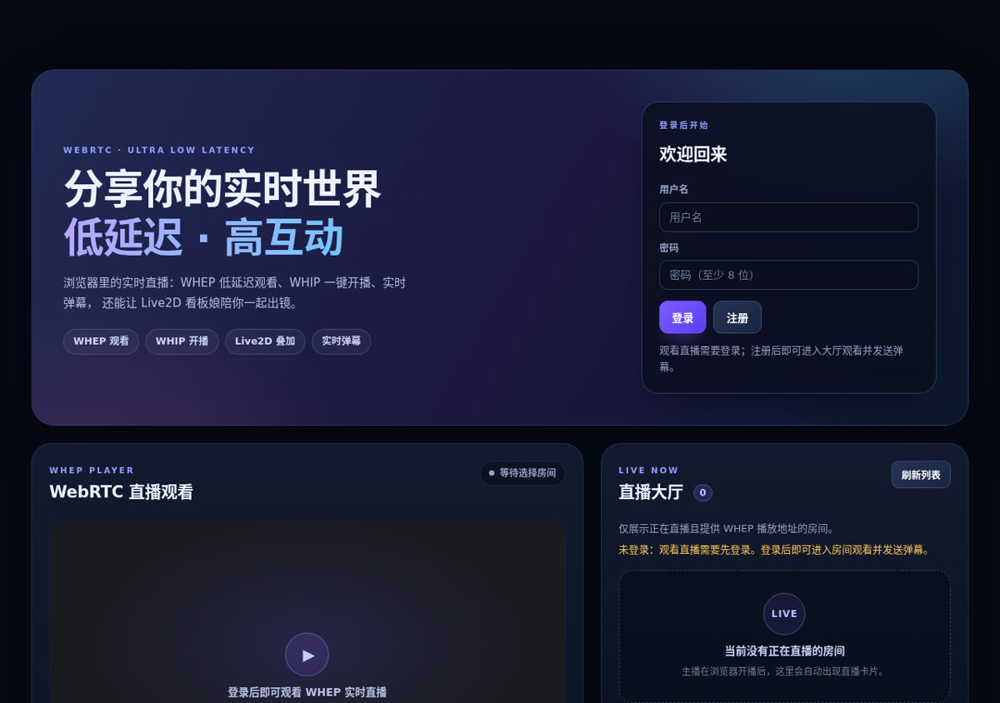

# CongLive

**Low-latency live streaming over WebRTC: publish from Android or the browser, watch on any device.**

[English](README.en.md) | [中文](README.md)

[](LICENSE)
[](https://webrtc.org/)
[](https://github.com/chilan0852/CongLIVE/actions/workflows/ci.yml)



## Features

- **Android publishing**: native Kotlin app with Camera2 (Camera1 fallback) and screen capture, WHIP publishing, WHEP playback, camera switching, local preview, resolution/FPS controls and MP4 recording playback.
- **Browser publishing**: React + TypeScript; `getUserMedia` / `getDisplayMedia` → WHIP, quality controls and live preview.
- **Windows portable client**: an Electron-packaged `CongLive.exe` with configurable server domain/IP, camera, microphone, screen sharing and a PC layout.
- **Studio + voice room**: a four-step `/studio` (camera/screen, mic level, Live2D overlay, cover/quality) and full-duplex WebRTC mesh voice inside rooms.
- **Standalone room page**: click a live cover in the lobby to open `/room/<id>` with player, chat, viewer count and live latency.
- **Live metrics**: WHEP `getStats` latency monitoring and SRS viewer counts; the lobby shows viewer counts.
- **Capacity-gated 1080p60**: 1080p/60fps is offered only when `/api/capacity` reports enough server resources; the 2C2G reference server disables it.
- **Web viewing**: low-latency WHEP playback, live room directory, sign-up/login and real-time chat.
- **Room features**: custom covers (upload/compress/display), chat, SRS RTC→RTMP DVR recording and an admin dashboard.
- **Bilingual UI**: switch instantly between Chinese and English in Web, Android and the admin console; the choice is remembered.
- **Plugin extensions**: backend plugin manager, event hooks (created/published/unpublished), admin toggles, and built-in `welcome` / `stream-audit` examples.
- **Live2D loader**: Web and Android can load user-supplied `.model3.json` files; browser publishing can composite the model into the stream. No models are bundled.

## Architecture

```text
Android Camera2 / screen capture ── WHIP ─┐
Browser camera / screen share ───── WHIP ──┤
                                          ▼
                         Node.js API (JWT auth / SRS hooks)
                                          │ internal WHIP/WHEP
                                          ▼
                                     SRS 6 SFU
                          ├── WHEP → Android / browser playback
                          └── RTC → RTMP → DVR → MP4 recording

Web / Android ── HTTPS: accounts, rooms, covers, recordings
Web / Android ── WebSocket: real-time chat
Admin ── /admin: users / rooms / recordings / plugins / audit
```

## Quick start

### Docker deployment

Requirements: Linux (Ubuntu 22.04/24.04 or Debian 12), Docker + Compose, and a domain (recommended for automatic HTTPS).

```bash
git clone https://github.com/chilan0852/CongLIVE.git
cd CongLIVE
sudo DOMAIN=live.example.com bash server/install.sh
```

The installer generates `server/.env`, `server/srs.runtime.conf` and TLS configuration, then starts MySQL, the API, SRS, the web client and Caddy. Open **80/443** plus **TCP 8000 / UDP 8000** in your cloud firewall.

> SRS defaults to **WebRTC over TCP 8000** for CGNAT/restricted networks that remap UDP ports. If UDP works on your network, change `protocol` in `server/srs.conf` to `udp` or `all` and re-run the installer.

### Local development

```bash
# backend (Node 22 + MySQL 8)
cd backend
npm ci
npm test
npm run dev

# web
cd ../web
npm ci
npm run typecheck
npm run build      # or npm run dev
```

### Android

```bash
cd android
# JDK 17, Android SDK 35, Gradle 8.11+
gradle :app:assembleDebug
```

APK output: `android/app/build/outputs/apk/debug/app-debug.apk`. In the app, open **Me → Server settings** and enter your API origin (e.g. `https://live.example.com`).

### Windows portable client

- Download `CongLive-win32-x64-portable.zip` from the [latest release](https://github.com/chilan0852/CongLIVE/releases/latest).
- Unzip and run `CongLive.exe` (Windows 10/11 x64 portable; no installer).
- On first launch enter the server domain/IP (default `https://xinglan.work`); press `Ctrl+Shift+S` later to change it.
- Camera, microphone and screen sharing supported. The build is unsigned, so SmartScreen may warn.

### Android APK download

- [Latest release](https://github.com/chilan0852/CongLIVE/releases/latest)
- `v0.7.9` room/latency APK: `com.conglive.app` / versionCode 21 / minSdk 29 / targetSdk 34
- No Live2D models are bundled; the APK is for testing.

## Plugin extensions

Plugins live in `backend/plugins/`, loaded by `backend/src/plugin-manager.js`. They can listen to:

- `stream.created` — a room is created
- `stream.published` — a publisher goes live
- `stream.unpublished` — a publisher stops

`GET /api/plugins` lists enabled plugins; `GET/PATCH /api/admin/plugins` lets an admin inspect and toggle them. See `backend/plugins/plugin-template` and `backend/plugins/README.md`.

## Live2D notes

- This repository does **not** include Cubism models, textures or the Cubism Core runtime; it only ships loaders.
- Enter a `.model3.json` URL in the Web UI to load a model; the model host must allow CORS.
- Browser publishing can composite the model into the WHIP stream via a canvas pipeline.
- Android currently shows Live2D as an in-app mascot (WebView) and does not composite it into WebRTC publishing.

## Configuration

See `server/.env.example` and `backend/.env.example`. **Never commit `.env`, `server/srs.runtime.conf`, private keys or recordings** — they are excluded by `.gitignore`.

## Project layout

```text
android/          Kotlin client: capture, WHIP/WHEP, preview, covers, Live2D
web/              React client: directory, WHEP, browser WHIP, covers, Live2D
webui/            admin.html dashboard
pc/               Windows Electron portable client
backend/          Express API, auth proxy, SRS hooks, plugins, tests
server/           Compose, SRS, Caddy, install.sh
docs/             README screenshots and notes
```

## Known limitations

- TCP-only by default is a CGNAT workaround; latency/throughput are slightly worse than UDP. Deploy TURN for restrictive NATs.
- AudioPlaybackCapture is not implemented; microphone audio is captured.
- Android Live2D does not enter the live stream (Web supports compositing).
- Browser publishing requires a secure HTTPS context; HTTP + IP is suitable for viewing only.
- Horizontal scaling, multi-node SFU and per-room concurrency limits are not implemented.

## Legal & compliance

Read [DISCLAIMER.en.md](DISCLAIMER.en.md): this project is for technical study and self-hosted demos, **not legal advice**, and provides no content moderation, filing or licensing. See [THIRD_PARTY_NOTICES.md](THIRD_PARTY_NOTICES.md) and [docs/COMPLIANCE.en.md](docs/COMPLIANCE.en.md).

## Brand & copy

Taglines, voiceover and social copy: [docs/BRAND.md](docs/BRAND.md).

## Security

Read [SECURITY.md](SECURITY.md). Never paste secrets, admin passwords or server credentials into a public issue.

## Contributing

Issues and PRs are welcome. See [CONTRIBUTING.md](CONTRIBUTING.md).

## License

[MIT](LICENSE) © 2026 chilan0852
