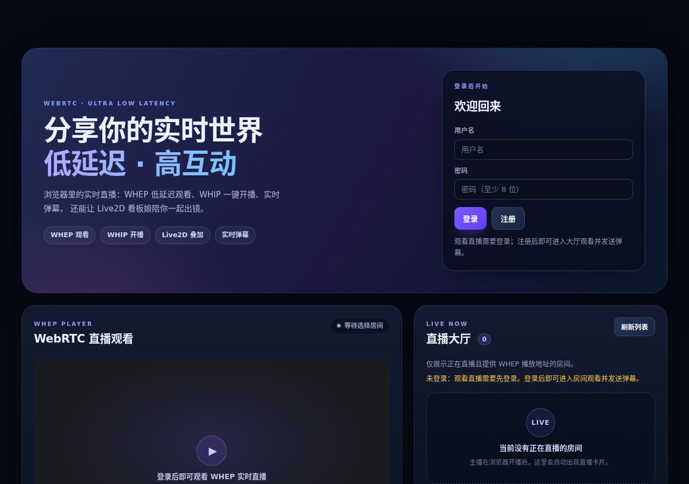

# CongLive 葱直播

[English](README.en.md) | 中文

**WebRTC 超低延迟直播：Android 手机开播、浏览器开播、双端 WHEP 观看。**

[](LICENSE)
[](https://webrtc.org/)
[](https://github.com/chilan0852/CongLIVE/actions/workflows/ci.yml)



## 功能

- **Android 开播**：Kotlin 原生，Camera2（Camera1 回退）/ 屏幕共享，WHIP 推流、WHEP 观看、前后摄切换、本地预览、分辨率/帧率选择、MP4 录像回放。
- **浏览器开播**：React + TypeScript，`getUserMedia` / `getDisplayMedia` → WHIP，分辨率/帧率选择，实时预览。
- **Windows 便携客户端**：Electron 打包的 `CongLive.exe`，可配置任意服务器域名/IP，支持摄像头、麦克风、屏幕共享和 PC 宽屏布局。
- **独立直播间页面**：大厅点击正在直播的封面进入 `/room/<id>`，含播放器、弹幕、观看人数与实时延迟。
- **开播工作台 + 语音房**：`/studio` 四步开播（摄像头/屏幕、麦克风电平、Live2D 叠加、封面/画质）；房间内支持 WebRTC mesh 全双工语音。
- **实时指标**：WHEP `getStats` 延迟监控、SRS 观看人数统计；大厅卡片直接显示人数。
- **1080p60 条件开启**：1080p/60fps 仅在 `/api/capacity` 判断服务器资源足够时开放，2C2G 默认禁用。
- **Web 观看**：WHEP 低延迟播放、直播大厅、登录注册、实时弹幕。
- **直播间能力**：自定义封面（上传/压缩/展示）、弹幕、SRS RTC→RTMP DVR 录像、后台管理。
- **中英双语**：Web、Android 和管理后台均可在中文 / English 之间即时切换并记住选择。
- **插件扩展**：后端插件管理器、事件钩子（直播创建/开播/下播）、管理后台插件开关、内置 `welcome` / `stream-audit` 示例。
- **Live2D 加载器**：Web 与 Android 均可加载用户自备的 `.model3.json`；Web 推流支持把模型合成进画面。仓库不内置任何模型资源。

## 媒体架构

```text
Android Camera2 / 屏幕采集 ── WHIP ─┐
浏览器摄像头 / 屏幕共享 ───── WHIP ──┤
                                    ▼
                          Node.js API（JWT 鉴权 / SRS hooks）
                                    │ 内部 WHIP/WHEP
                                    ▼
                              SRS 6 SFU
                       ├── WHEP → Android / 浏览器播放
                       └── RTC → RTMP → DVR → MP4 录像

Web / Android ── HTTPS：账号、直播间、封面、录像
Web / Android ── WebSocket：实时弹幕
管理员 ── /admin：用户 / 直播 / 录像 / 插件 / 审计
```

## 快速开始

### 一键部署（Docker）

要求：Linux（Ubuntu 22.04/24.04 或 Debian 12）、Docker + Compose、域名（推荐，用于自动 HTTPS）。

```bash
git clone https://github.com/chilan0852/CongLIVE.git
cd CongLive
sudo DOMAIN=live.example.com bash server/install.sh
```

安装器会生成 `server/.env`、`server/srs.runtime.conf` 和自签/自动 TLS 配置，启动 MySQL、API、SRS、Web 与 Caddy。云防火墙需放行 **80/443** 以及 **UDP 8000、TCP 8000**。

> SRS 默认使用 **WebRTC over TCP 8000**，兼容会重映射 UDP 端口的运营商 CGNAT 网络。UDP 正常的网络可把 `server/srs.conf` 的 `protocol` 改为 `udp` 或 `all` 后重跑安装器。

### 本地开发

```bash
# backend（Node 22 + MySQL 8）
cd backend
npm ci
npm test
npm run dev

# web
cd ../web
npm ci
npm run typecheck
npm run build      # 或 npm run dev
```

### Windows 便携客户端

- 从 [最新 Release](https://github.com/chilan0852/CongLIVE/releases/latest) 下载 `CongLive-win32-x64-portable.zip`
- 解压后运行 `CongLive.exe`（Windows 10/11 x64 便携版，无需安装）
- 首次启动填写服务器域名/IP（默认 `https://xinglan.work`）；之后按 `Ctrl+Shift+S` 可修改
- 支持摄像头、麦克风、屏幕共享；未签名构建，SmartScreen 可能提示

### Android APK 下载

- [最新 Release](https://github.com/chilan0852/CongLIVE/releases/latest)
- `v0.7.9` 独立房间/1080p60/延迟 APK：`com.conglive.app` / code 21 / minSdk 29 / targetSdk 34
- 仓库不包含 Live2D 模型；APK 仅用于测试安装。

### Android

```bash
cd android
# 需要 JDK 17、Android SDK 35、Gradle 8.11+
gradle :app:assembleDebug
```

APK 输出：`android/app/build/outputs/apk/debug/app-debug.apk`。App 内「我的 → 服务器设置」填 API 根地址（例如 `https://live.example.com`）。

## 插件扩展

插件位于 `backend/plugins/`，通过 `backend/src/plugin-manager.js` 加载，可监听：

- `stream.created`：创建直播间
- `stream.published`：开播
- `stream.unpublished`：下播

`GET /api/plugins` 返回启用插件，`GET/PATCH /api/admin/plugins` 由管理员查看/开关。参考 `backend/plugins/plugin-template` 和 `backend/plugins/README.md`。

## Live2D 说明

- 仓库**不包含** Cubism 模型、纹理或 Core 运行时；Web/Android 端仅提供加载器。
- Web 端输入 `.model3.json` 地址即可加载；模型服务器必须允许 CORS。
- 浏览器开播可勾选「叠加 Live2D」，模型经 canvas 合成进推流画面。
- Android 当前仅做界面看板娘（WebView），不把模型合成进 WebRTC 推流。

## 配置

主要环境变量见 `server/.env.example`、`backend/.env.example`。**不要提交 `.env`、`server/srs.runtime.conf`、证书私钥或录像文件**；这些已在 `.gitignore` 中排除。

## 目录

```text
android/          Kotlin 客户端：采集、WHIP/WHEP、预览、封面、Live2D 入口
web/              React 用户端：大厅、WHEP、浏览器 WHIP、封面、Live2D
webui/            admin.html 管理后台
pc/               Windows Electron portable client
backend/          Express API、鉴权代理、SRS hooks、插件、测试
server/           Compose、SRS、Caddy、install.sh
docs/             README 截图等
```

## 已知限制

- 默认 TCP-only 是为了兼容 CGNAT；延迟/吞吐略逊于 UDP。极端 NAT 环境建议部署 TURN。
- AudioPlaybackCapture 尚未接入（系统音频/内录），当前采集麦克风音频。
- Android Live2D 不进入直播画面（Web 端支持叠加）。
- 浏览器推流需要 HTTPS 安全上下文；HTTP + IP 仅适合观看。
- 同一账号/房间的并发、分布式部署与水平扩展尚未实现。

## 法律与合规

使用前请阅读 [DISCLAIMER.md](DISCLAIMER.md)：本项目仅供技术学习/自建演示，不构成法律意见，不提供内容审核、备案或授权。第三方组件许可见 [THIRD_PARTY_NOTICES.md](THIRD_PARTY_NOTICES.md)，工程检查记录见 [docs/COMPLIANCE.md](docs/COMPLIANCE.md)。

## 品牌与文案

品牌 Slogan、短视频旁白和社交文案见 [docs/BRAND.md](docs/BRAND.md)。

## 安全

请阅读 [SECURITY.md](SECURITY.md)。不要在公开 Issue 中贴密钥、管理员密码或服务器凭据。

## 贡献

欢迎 Issue / PR，见 [CONTRIBUTING.md](CONTRIBUTING.md)。

## License

[MIT](LICENSE) © 2026 chilan0852
